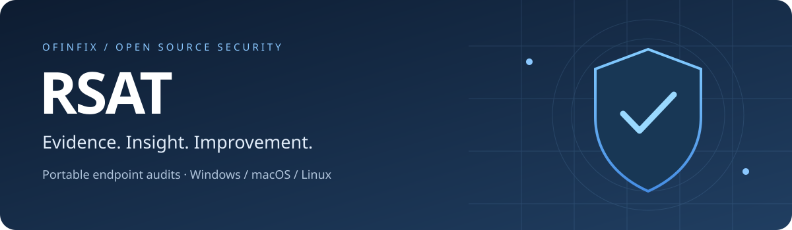
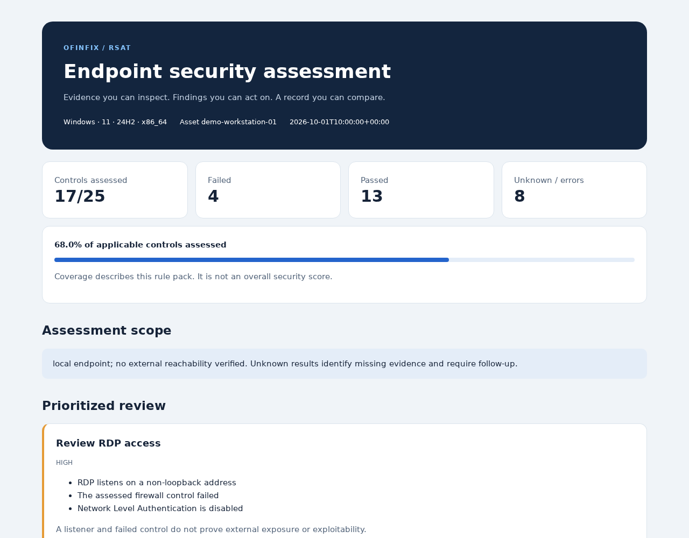
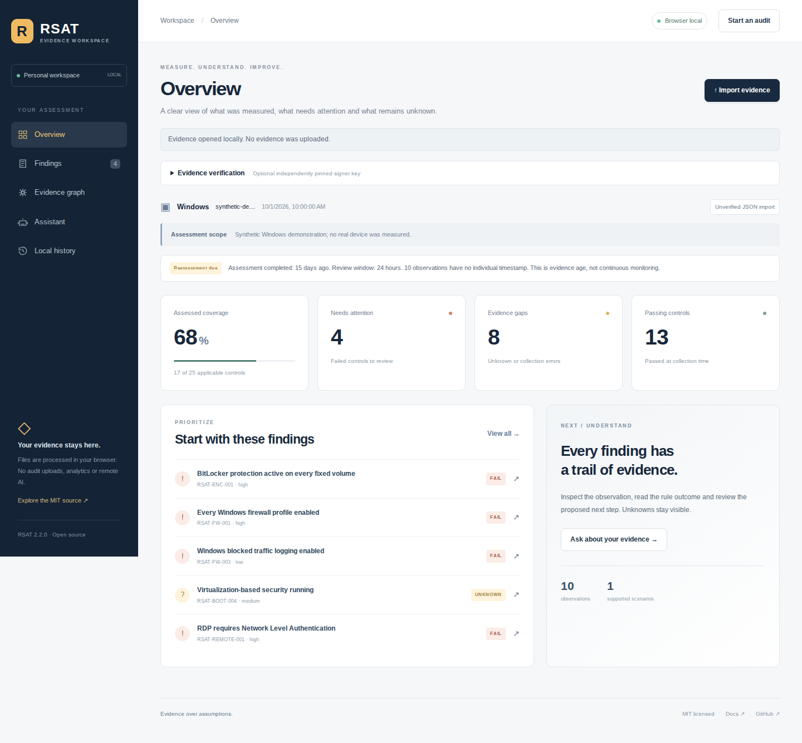
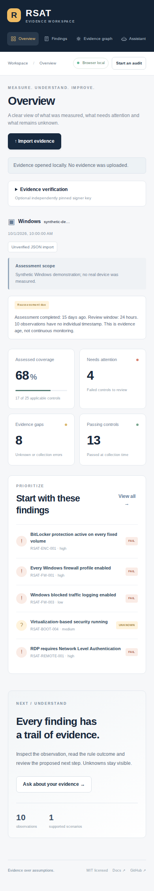

<p align="center">
  
</p>

<p align="center">
  <a href="https://github.com/Kajahkura/RSAT_Project/actions/workflows/build.yml"></a>
  
  <a href="LICENSE"></a>
  
  
</p>

<p align="center"><strong>Endpoint security assessments you can inspect and repeat.</strong></p>

<p align="center">
  <a href="#what-rsat-checks">What RSAT checks</a> · <a href="#quick-start">Quick start</a> · <a href="https://rsat-workspace.blinkhost.website">Web workspace</a> · <a href="docs/usage.md">Usage guide</a> · <a href="docs/validation.md">Validation</a> · <a href="CONTRIBUTING.md">Contribute</a>
</p>

RSAT (Remote Security Audit Tool) is an open-source tool that helps you review the security configuration of a Windows, macOS or Linux device and decide what to address next. It collects configuration evidence through a bounded, read-only assessment and produces findings, a portable report and a remediation plan.

Security settings are spread across system menus, management tools and command output. A disabled firewall profile, paused disk protection or weak remote-access setting can be easy to overlook. RSAT brings these observations into a consistent review, explains the rule behind each result and lets you compare assessments after changes.

It is designed for system administrators checking device baselines, security practitioners reviewing configurations, consultants preparing client assessments, and developers inspecting workstations and local AI tools. The aim is to make repeatable security review accessible, with open code, understandable findings and evidence that operators can keep under their control.

## What RSAT checks

RSAT uses native operating-system interfaces to assess the settings available on the device. The checks reflect each platform's protections and the evidence it can provide.

| Platform | Key checks |
|---|---|
| **Windows** | BitLocker protection and encryption; effective firewall profiles and network listeners; Microsoft Defender state; Secure Boot, TPM and VBS; RDP Network Level Authentication, SMB settings, local identity and update indicators |
| **macOS** | FileVault; application firewall and network listeners; System Integrity Protection (SIP), authenticated root and Gatekeeper; SSH, guest and administrator accounts; update history, Time Machine backup evidence and device-management enrollment |
| **Linux** | Storage inventory; nftables input policy and TCP listeners; effective SSH configuration and UID-zero (root-level) accounts; Secure Boot where supported; update/reboot indicators, automatic update timers and auditd |

Optional inventory and advisory matching help review installed software. AI tooling checks inspect identified model-service listeners and explicitly supplied Model Context Protocol (MCP) configurations for access-boundary and permission concerns. Runtime enforcement and external reachability require separate verification.

Checks depend on device role, OS support and collection privileges. Missing or inaccessible evidence stays visible as UNKNOWN or ERROR. See the [platform guide](docs/platform.md) for coverage and limitations.

## From assessment to follow-up

Every finding links to recorded evidence and a versioned rule. PASS, FAIL, UNKNOWN, ERROR and NOT_APPLICABLE remain distinct, and coverage shows how much of the applicable policy was assessed.

| Workflow | What you can do |
|---|---|
| **Inspect findings** | Review outcomes, observations, severity and recommended next steps in HTML reports or the browser workspace |
| **Understand context** | Explore evidence relationships, listening services and supported risk scenarios |
| **Reassess a device** | Compare audits, highlight recorded regressions, check evidence freshness and distinguish policy or scope changes from outcome changes |
| **Prepare client reports** | Export selected findings as JSON/CSV or create a redacted HTML report that can be printed to PDF |
| **Track remediation** | Record decisions and review dates, save encrypted local history and collect fresh evidence to verify a fix |
| **Protect evidence** | Sign bundles, verify independently pinned signer keys and use optional encrypted transfers |

The native CLI also supports collection through existing SSH or HTTPS WinRM access, SBOM exports and evidence-grounded assistance through a local model. Integration details are in the [usage](docs/usage.md) and [platform](docs/platform.md) guides.

<details>
<summary>Standalone audit report</summary>



</details>

## Browser workspace

The [live workspace](https://rsat-workspace.blinkhost.website) guides collector installation, opens evidence locally and provides a place to inspect findings, review reassessments and prepare reports. Collection runs on the endpoint; the browser processes the resulting audit files. No account or required backend is needed, and imports, device labels and remediation notes stay in your browser.



<details>
<summary>Mobile preview</summary>



</details>

*All screenshots use synthetic evidence.*

The workspace is also available as a [static release download](https://github.com/Kajahkura/RSAT_Project/releases/latest) for [self-hosting](docs/deployment.md).

## Quick start

Download the collector for your OS from the [latest release](https://github.com/Kajahkura/RSAT_Project/releases/latest), verify its checksum/provenance and follow the command shown in the [web workspace](https://rsat-workspace.blinkhost.website). You can also install from source:

```bash
git clone https://github.com/Kajahkura/RSAT_Project.git
cd RSAT_Project
python -m venv .venv
source .venv/bin/activate  # Windows PowerShell: .venv\Scripts\Activate.ps1
python -m pip install -e .
rsat audit
```

Open `audit-output/<audit-id>/report.html`, or import the accompanying `audit.json` into the workspace. Each assessment gets a unique output folder. Run with the privileges appropriate for your engagement when native checks need them; RSAT does not automatically elevate or apply fixes.

```bash
# Include software inventory and bounded live update checks
rsat audit --inventory --update-search --deadline 120 --command-timeout 20

# Compare two assessments of the same device
rsat diff before/audit.json after/audit.json --output changes.json
```

For repeat collection, preserve the same device identity and engagement salt. Remediation decisions do not change measured outcomes; re-audit to verify improvement. The [usage guide](docs/usage.md) covers signing, exceptions, remote collection and explicit remediation workflows.

## Development and open source

RSAT uses Python for orchestration and policies, PowerShell/CIM for Windows queries, native macOS/Linux interfaces, and React/TypeScript for the browser workspace. Collectors, versioned rules and reporting are separate so contributors can extend coverage without replacing the audit workflow. See the [architecture](docs/architecture.md) and [contributor guide](CONTRIBUTING.md).

CI tests Python 3.11/3.13 across Linux, Windows and both macOS architectures, exercises browser workflows and smoke-tests standalone builds. Releases include checksums, build inventories and signed provenance. The [validation record](docs/validation.md) documents measured results and native platform limits, including current OS-signing and notarization status.

RSAT code, original controls, reports and repository artwork are [MIT licensed](LICENSE). Optional integrations, intelligence data and local models retain their own licenses; see [third-party notices](docs/third-party-notices.md). Changes are recorded in the [changelog](CHANGELOG.md).

RSAT provides a point-in-time assessment. Coverage is not an overall security score, and an audit does not certify compliance or establish that a device is uncompromised.
